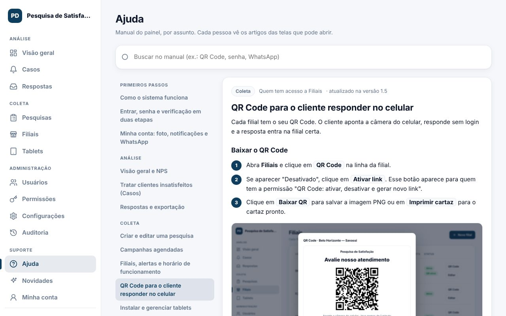
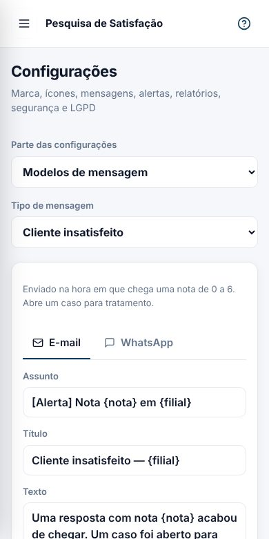
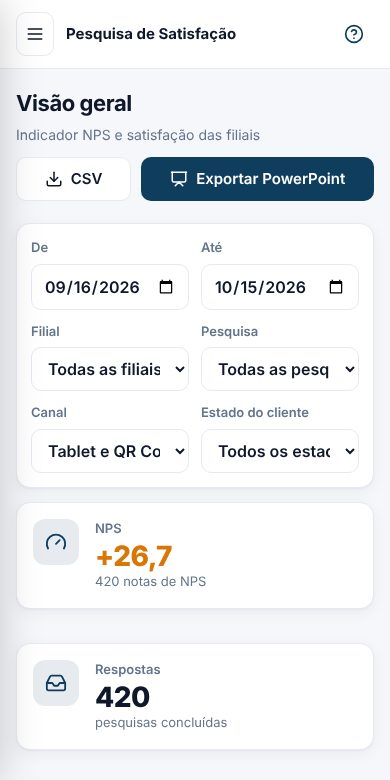

# Notas de versão

Gerado a partir de `public/admin/novidades.json` (o mesmo conteúdo do menu **Novidades** do painel).

## 1.5.0 — 16/10/2026

### Novo
- **Perfis e permissões por menu.** Crie perfis como "Supervisor regional" e marque, em cada menu, o que o perfil pode ver, incluir, editar e excluir, além de ações específicas como exportar CSV ou ver o contato do cliente. O servidor confere tudo, e as mudanças vão para a auditoria.

  

- **WhatsApp conectado pelo QR Code.** Conecte o número da empresa lendo um QR Code, como no WhatsApp Web. Os alertas vão para várias pessoas, um por vez, com pausa sorteada de 15 a 60 segundos entre cada envio. A API oficial da Meta continua disponível.

  

- **Textos das mensagens com prévia.** Edite o texto de cada aviso, no e-mail e no WhatsApp, com variáveis como {filial} e {nota}, e veja na hora como a mensagem vai chegar.

  

- **Foto em Minha conta.** Envie uma foto, recorte em círculo e ajuste o zoom. Ela aparece no menu, na lista de usuários e nos casos.

  

- **Ramificação conforme a resposta.** Em cada pergunta de nota, sim/não ou opções, defina para onde o cliente vai conforme a resposta: pular para uma pergunta adiante ou encerrar a pesquisa. Ex.: notas de 0 a 6 vão para "O que deu errado?" e notas 9 e 10 encerram.
- **Manual de ajuda e notas de versão.** Menu Ajuda com artigos por assunto, busca e o botão "?" em cada tela. Cada pessoa vê os artigos das telas que pode abrir. As novidades de cada versão ficam neste menu.

  

### Melhoria
- **Prazos de guarda de até 10 anos.** Comentários, contatos, localização e auditoria podem ser guardados por até 10 anos, escolhidos em anos. A localização ganhou prazo próprio. As notas continuam sem prazo, porque são a base dos relatórios.

  

- **Todo o painel ajustado para celular.** No celular, as guias viram uma lista de seleção, as janelas ocupam a tela inteira com os botões sempre visíveis e os botões ficaram maiores para o toque. Um teste automático confere 31 telas em 360 px.

  

- **2FA também para perfis que alteram o sistema.** Quando a empresa exige 2FA, ele vale para administradores e para qualquer perfil que possa alterar usuários, permissões ou configurações.
- **NPS de 0 a 100.** O NPS agora vai de 0 a 100, como no padrão usado pela empresa: 50 é o ponto de equilíbrio entre promotores e detratores. As metas já cadastradas foram convertidas automaticamente para a nova escala.
- **Painel em tempo real.** Ativar um QR Code, cadastrar ou alterar algo aparece na hora para todos que estão com o painel aberto, assim como as respostas e casos novos, sem recarregar a página. Se você estiver editando um formulário, um aviso oferece a atualização sem perder o que foi digitado.
- **Cards de Promotores e Detratores abrem as respostas.** Na Visão geral, clique em Promotores ou Detratores para ver as respostas daquele grupo, com o mesmo período e filial.
- **Seta discreta para recolher o menu.** A seta para recolher e expandir o menu lateral fica no alto, ao lado do nome, e só se destaca ao passar o mouse.
- **Marca Sauberlich System © no tablet.** As telas do tablet e do QR Code mostram, discretamente, a marca do sistema.

### Correção
- **Respostas depois das 23h apareciam no dia seguinte.** Cada resposta agora conta no dia do horário local do tablet (o fuso da filial), em filtros, gráficos, casos, relatórios e CSV, qualquer que seja o fuso do servidor.
- **Prazo de "10 anos" apagava dados uns dias antes.** A limpeza automática contava meses de 30 dias. Agora usa o mês médio do calendário, então 10 anos são 10 anos.
- **"null" aparecia em Configurações e no QR Code.** Um texto "null" aparecia acima das guias de Configurações e na janela do QR Code de uma filial ainda sem link.
- **Esc não fechava as janelas.** A tecla Esc agora fecha a janela aberta.

## 1.4.0 — 10/10/2026

### Novo
- **Fuso horário por filial.** Cada filial usa o fuso informado pelo tablet, um fuso fixo ou o fuso da empresa. Horário de funcionamento, campanhas e alertas seguem o fuso da filial.

  

## 1.3.0 — 05/10/2026

### Novo
- **Localização das respostas pelo QR Code.** Com a autorização do cliente, o sistema grava cidade, estado e região aproximados, sem serviços externos. Aparece em Respostas, nos filtros e no quadro "Origem das respostas".
- **E-mail e WhatsApp configurados pelo painel.** Servidor de e-mail e WhatsApp da Meta configurados na tela, com senha e token criptografados e botões de teste.

### Melhoria
- **Painel no celular.** No celular, o menu vira uma gaveta e as tabelas viram cartões.

  

- **Auditoria em português simples.** Cada ação aparece como uma frase, com filtros por tipo e destaque para o que merece atenção.
- **Respostas com localização e dispositivo.** Novas colunas mostram onde a resposta foi dada e em qual tablet ou tipo de celular.
- **Tela do tablet sempre acesa, com escurecimento.** O tablet fica aceso e escurece depois de um tempo sem toque, para economizar bateria.
- **Exclusão de respostas só para administrador.** Apagar respostas passou a ser restrito e registrado na auditoria.

### Correção
- **Código de pareamento do tablet sumia.** O código agora fica na tela pelos 15 minutos de validade.

## 1.2.0 — 04/10/2026

### Novo
- **Implantação em produção.** Imagem Docker endurecida, HTTPS automático (Caddy) ou nginx, backup diário e testes automáticos a cada alteração.

### Melhoria
- **Revisão de segurança.** Revisão completa de segurança e da documentação de implantação.

## 1.1.0 — 04/10/2026

### Novo
- **Casos de clientes insatisfeitos.** Cada nota de 0 a 6 abre um caso com status, responsável e histórico, e avisa a filial por e-mail, webhook ou WhatsApp.

  

- **QR Code por filial.** O cliente responde no próprio celular. Cartaz pronto para imprimir e proteção contra abuso.

  

- **Verificação em duas etapas e recuperação de senha.** Código do aplicativo autenticador, 10 códigos de recuperação e "Esqueci minha senha" por e-mail.
- **Campanhas, perguntas condicionais e idiomas.** Pesquisas temporárias por período, perguntas que aparecem conforme a resposta e pesquisas em português, inglês e espanhol.
- **Relatório semanal, metas e ranking.** PowerPoint semanal por e-mail, meta de NPS por filial e ranking na visão geral.
- **LGPD.** Aviso de privacidade, contato só com consentimento, pedidos do titular e limpeza automática por prazo.

## 1.0.0 — 03/10/2026

### Novo
- **Primeira versão.** Pesquisa de satisfação multi-filial com tablets em modo quiosque, NPS, painel com filtros, exportação em CSV e PowerPoint, perfis de administrador e gestor de filial e auditoria.
