# Manual do painel — versão 1.5.0

Este arquivo é gerado a partir do menu **Ajuda** do painel (`npm run docs:manual`). Não edite aqui: edite `public/admin/ajuda/*.md`.

- **Primeiros passos**: [Como o sistema funciona](#como-funciona) · [Entrar, senha e verificação em duas etapas](#entrar-2fa) · [Minha conta: foto, notificações e WhatsApp](#minha-conta)
- **Análise**: [Visão geral e NPS](#visao-geral) · [Tratar clientes insatisfeitos (Casos)](#casos) · [Respostas e exportação](#respostas)
- **Coleta**: [Criar e editar uma pesquisa](#pesquisas) · [Campanhas agendadas](#campanhas) · [Filiais, alertas e horário de funcionamento](#filiais) · [QR Code para o cliente responder no celular](#qr-code) · [Instalar e gerenciar tablets](#tablets)
- **Administração**: [Usuários](#usuarios) · [Perfis e permissões](#permissoes) · [E-mail e WhatsApp (QR Code ou API da Meta)](#email-whatsapp) · [Textos das mensagens (modelos)](#modelos-mensagem) · [Alertas, metas e relatório semanal](#alertas-relatorios) · [Identidade visual e ícones](#identidade) · [Segurança, LGPD e prazos de guarda](#lgpd) · [Auditoria](#auditoria)
- **Dúvidas**: [Perguntas frequentes](#perguntas-frequentes)

## Primeiros passos

### Como o sistema funciona

O sistema coleta a opinião dos clientes de todas as filiais e mostra tudo num só painel, com o indicador **NPS**.

#### As três partes
- **Tablet na loja**: fica em modo quiosque com a pesquisa aberta. O cliente responde sem login. Cada tablet pertence a uma única filial, então as respostas nunca se misturam.
- **QR Code da filial**: o cliente aponta a câmera do celular e responde em casa ou na fila, sem baixar nada.
- **Painel** (esta tela): onde a equipe acompanha os números, trata os clientes insatisfeitos e configura tudo.

#### O que acontece quando chega uma resposta
1. A resposta entra na filial certa e já aparece na **Visão geral** e em **Respostas**.
2. Se a nota de NPS for de 0 a 6, o sistema abre um **caso** em **Casos** e avisa as pessoas da filial por e-mail e, se estiver configurado, por WhatsApp.
3. Toda semana, quem quiser recebe o **relatório em PowerPoint** por e-mail.

#### O que cada pessoa vê
O que aparece no menu depende do **perfil de acesso** da pessoa. Um gestor de filial, por exemplo, só vê as filiais ligadas a ele. Os perfis são definidos em [Perfis e permissões](#permissoes).

> Dica: o botão redondo com "?" no canto da tela abre o artigo do manual sobre a tela em que você está.

### Entrar, senha e verificação em duas etapas

#### Entrar
Use o seu e-mail e a senha. A senha precisa ter pelo menos 10 caracteres, com letras e números.

- Depois de **5 senhas erradas seguidas**, a conta fica bloqueada por 15 minutos.
- A sessão termina sozinha depois de 2 horas sem uso e, no máximo, 12 horas depois de entrar.

#### Esqueci minha senha
1. Na tela de entrada, clique em `Esqueci minha senha` e informe o seu e-mail.
2. Abra o e-mail recebido e clique em **Criar nova senha**. O link vale por 30 minutos e funciona uma única vez.
3. Crie a nova senha e entre de novo.

#### Verificação em duas etapas (2FA)
Além da senha, o sistema pede um código de 6 números que muda a cada 30 segundos no seu celular.

1. Em [Minha conta](#minha-conta), clique em `Ativar 2FA` e confirme a senha.
2. Instale o Google Authenticator, Microsoft Authenticator ou Authy e leia o QR Code.
3. Digite o código que aparece no aplicativo.
4. Guarde os **10 códigos de recuperação** em local seguro. Cada um permite entrar uma vez se você perder o celular.

> Dica: a empresa pode tornar o 2FA obrigatório para administradores e para perfis que alteram usuários, permissões ou configurações. Nesse caso, o sistema pede a ativação logo no próximo login.

Perdeu o celular e os códigos? Peça a quem administra os usuários para **resetar o seu 2FA**. Você configura de novo no próximo login.

### Minha conta: foto, notificações e WhatsApp

Em **Minha conta** cada pessoa cuida dos próprios dados. Todos os perfis têm acesso.

#### Foto de perfil
1. Clique em `Enviar foto` (ou na própria foto) e escolha uma imagem JPG, PNG ou WEBP.
2. Arraste a foto para posicionar e use o **Zoom** para ajustar. Só a parte dentro do círculo aparece.
3. Clique em `Salvar foto`.

A foto aparece no menu lateral, na lista de usuários e nos casos (responsável e histórico). Ela só é vista por quem está logado no painel. Para tirar, clique em `Remover`.

#### Notificações
Marque o que você quer receber:
- **Cliente insatisfeito** (nota de 0 a 6) nas suas filiais.
- **Relatório semanal** em PowerPoint.
- **Tablet sem sinal** nas suas filiais.

#### Seu WhatsApp
Informe DDD + número (ex.: 11 99999-0000) para receber os alertas também pelo WhatsApp. Funciona quando o WhatsApp estiver ligado em [E-mail e WhatsApp](#email-whatsapp). Deixe em branco para não receber.

#### Trocar senha
Digite a senha atual e a nova duas vezes. Depois da troca, todas as suas sessões abertas são encerradas e você entra de novo.

## Análise

### Visão geral e NPS

A **Visão geral** mostra o NPS e a satisfação das filiais no período escolhido.

#### Filtros
Escolha o período (**De** e **Até**), a filial, a pesquisa, o canal (tablet ou QR Code) e o estado do cliente. Os números, gráficos e exportações seguem os filtros.

#### Como ler o NPS
- **Promotores**: notas 9 e 10. **Neutros**: 7 e 8. **Detratores**: 0 a 6.
- **NPS = % de promotores − % de detratores**. Vai de −100 a +100.
- Só entram no NPS as perguntas marcadas como **"Entra na análise de NPS"** no editor da pesquisa.

#### O que mais aparece
- **Evolução diária**: respostas por dia (barras) e NPS do dia (linha).
- **Distribuição das notas** de 0 a 10.
- **Ranking das filiais** com a meta de NPS de cada uma.
- **Origem das respostas pelo QR Code**: cidade e estado de quem autorizou a localização.
- **NPS por pergunta** e **comentários recentes**.

#### Exportar
- `Exportar PowerPoint`: relatório com gráficos editáveis, logo e cores da empresa.
- `CSV`: planilha com as respostas (abre no Excel).

> Dica: os botões de exportação só aparecem para perfis com essas permissões.

### Tratar clientes insatisfeitos (Casos)

Cada nota de NPS de 0 a 6 abre um **caso** para a equipe tratar. O objetivo é falar com o cliente e registrar o que foi feito.

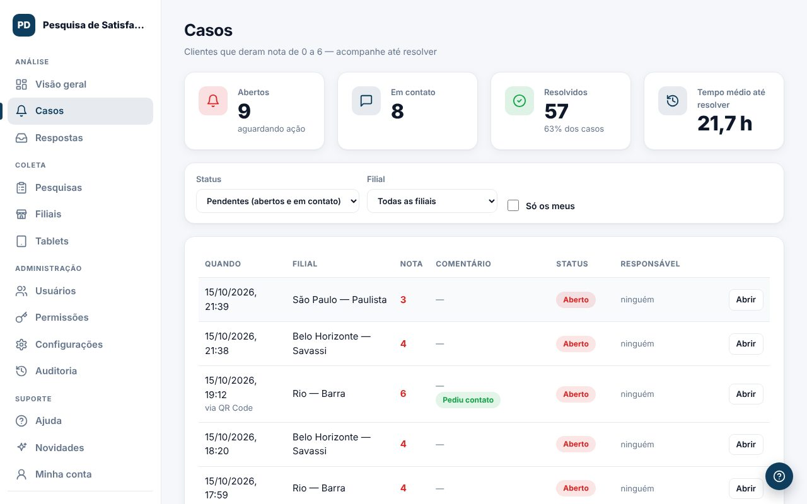

#### Tratar um caso
1. Em **Casos**, clique em `Abrir` no caso.
2. Leia as respostas e, se o cliente pediu contato, veja nome, telefone e e-mail.
3. Escolha o **Status** (Aberto, Em contato, Resolvido ou Sem retorno) e o **Responsável**.
4. Escreva uma **Anotação** com o que foi feito e clique em `Salvar`.

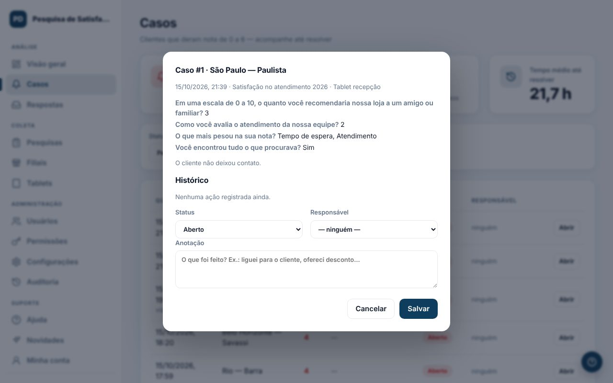

#### Filtros
- **Pendentes** mostra os abertos e em contato.
- **Só os meus** mostra os casos em que você é o responsável.

#### Bom saber
- O contato do cliente só aparece para perfis com a permissão "Ver contato do cliente". Cada visualização fica registrada na auditoria (LGPD).
- O histórico guarda quem mudou o status e quando.
- O tempo médio até resolver aparece no topo da tela.

### Respostas e exportação

Em **Respostas** você vê cada pesquisa recebida, dos tablets e dos QR Codes.

#### O que aparece em cada linha
- Data, filial e pesquisa.
- **Localização**: no QR Code, a cidade e o estado aproximados (só se o cliente autorizou); no tablet, a cidade da loja.
- **Dispositivo**: o nome do tablet ou o tipo de celular do cliente.
- Todas as respostas dadas.

#### Exportar
Use `CSV` para baixar a planilha com os filtros da tela. A exportação fica registrada na auditoria.

#### Excluir respostas
Perfis com a permissão **Respostas · Excluir** podem apagar uma resposta ou todas as filtradas (útil para limpar testes). Para excluir em lote, é preciso digitar **EXCLUIR**. Isso não pode ser desfeito.

## Coleta

### Criar e editar uma pesquisa

A pesquisa é o que o cliente vê no tablet e no QR Code.

#### Criar uma pesquisa
1. Em **Pesquisas**, clique em `Nova pesquisa`.
2. Preencha o título interno, a tela inicial e a tela de agradecimento.
3. Adicione as perguntas (até 30). Tipos: NPS de 0 a 10, escala de 1 a 5, escolha única, múltipla escolha, sim/não e texto livre.
4. Nas perguntas de 0 a 10, marque **"Entra na análise de NPS"** nas que contam para o indicador.
5. Clique em `Salvar pesquisa`.

#### Opções úteis
- **Aparência** das escalas: números coloridos, carinhas ou ícones. O valor gravado é sempre a nota de 0 a 10.
- **Perguntas condicionais**: mostre uma pergunta só para certas respostas (ex.: "O que podemos melhorar?" só para notas até 6).
- **Idiomas**: português, inglês e espanhol. Traduções vazias usam o texto em português.
- **Contato**: pergunte se o cliente quer ser contatado (nunca, só detratores ou todos). O contato só é gravado com autorização.
- **Imagem ou vídeo** de agradecimento (até 25 MB) e o tempo na tela.

> Dica: quando a pesquisa já tem respostas, dá para corrigir textos e a marcação de NPS, mas não mudar a estrutura. Para isso, use `Duplicar`.

#### Escolher a pesquisa dos tablets
A pesquisa padrão de cada filial é escolhida na tela [Filiais](#filiais).

### Campanhas agendadas

Uma **campanha** troca a pesquisa de uma filial (ou de todas) por um período e depois volta sozinha para a pesquisa padrão.

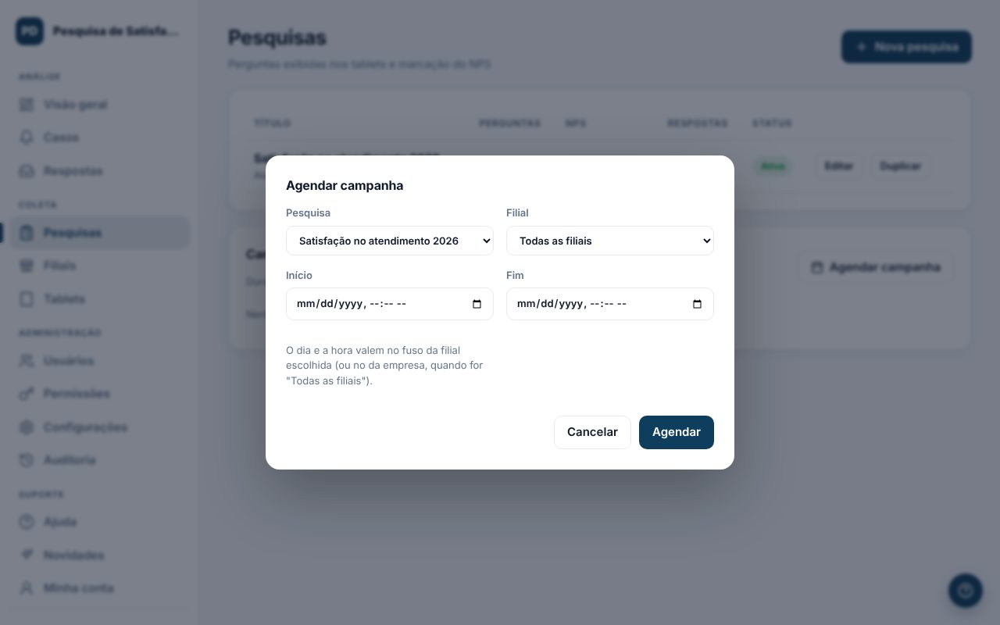

#### Agendar
1. Em **Pesquisas**, no quadro **Campanhas agendadas**, clique em `Agendar campanha`.
2. Escolha a pesquisa, a filial (ou "Todas as filiais"), o início e o fim.
3. Clique em `Agendar`.

#### Bom saber
- O dia e a hora valem no fuso da filial escolhida. Para "Todas as filiais", vale o fuso da empresa.
- Uma campanha dura no máximo 1 ano.
- Perfis que veem só as próprias filiais não agendam campanhas para todas as filiais.
- A situação aparece como **Agendada**, **No ar** ou **Encerrada**.

### Filiais, alertas e horário de funcionamento

Cada filial coleta separadamente e tem a sua pesquisa, seus alertas e seu horário.

#### Cadastrar ou editar
1. Clique em `Nova filial` ou em `Editar`.
2. Preencha código, nome, cidade e a **meta de NPS** (se vazia, vale a meta padrão).
3. Em **Alertas de cliente insatisfeito**, informe os e-mails e os números de WhatsApp da filial (DDI + DDD + número).
4. Escolha o **fuso horário** e, se quiser, o **horário de funcionamento** de cada dia.
5. Clique em `Salvar`.

#### Horário de funcionamento
Fora do horário, o tablet mostra uma tela de descanso e o sistema não avisa "tablet sem sinal". O QR Code continua aceitando respostas.

#### Pesquisa dos tablets
Na lista de filiais, escolha a pesquisa padrão na coluna **Pesquisa padrão dos tablets**. Os tablets recebem a mudança em até 1 minuto.

#### QR Code
O botão `QR Code` abre o link e o cartaz da filial. Veja [QR Code para o cliente](#qr-code).

### QR Code para o cliente responder no celular

Cada filial tem o seu QR Code. O cliente aponta a câmera do celular, responde sem login e a resposta entra na filial certa.

#### Baixar o QR Code
1. Abra **Filiais** e clique em `QR Code` na linha da filial.
2. Se aparecer "Desativado", clique em `Ativar link`. Esse botão aparece para quem tem a permissão "QR Code: ativar, desativar e gerar novo link".
3. Clique em `Baixar QR` para salvar a imagem PNG ou em `Imprimir cartaz` para o cartaz pronto.

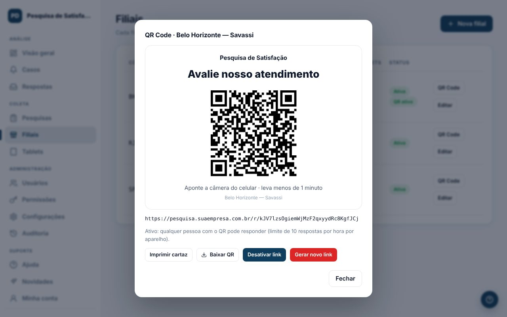

#### Proteções
- Cada aparelho pode enviar até 10 respostas por hora.
- Pelo QR Code, o cliente pode autorizar a localização aproximada (cidade e estado). Sem autorização, a resposta é aceita do mesmo jeito.
- O horário de funcionamento vale só para o tablet: pelo QR, o cliente pode responder depois.

> Dica: `Gerar novo link` faz os cartazes já impressos pararem de funcionar. Use só se o QR Code tiver sido divulgado onde não devia.

### Instalar e gerenciar tablets

Cada tablet fica ligado a uma única filial. As respostas coletadas nele são sempre gravadas nessa filial.

#### Instalar um tablet
1. Em **Tablets**, clique em `Novo tablet`, escolha a filial e dê um nome (ex.: Tablet recepção).
2. Clique em `Gerar código`. O código de 8 letras vale por 15 minutos e funciona uma única vez.
3. No tablet, abra o endereço mostrado na tela (termina em `/kiosk/`) e digite o código.
4. Siga o `Guia de instalação` para travar o tablet no modo quiosque (Android com Fully Kiosk ou iPad com Acesso Guiado).

#### Situação de cada tablet
- **Online**: falou com o sistema nos últimos 3 minutos.
- **Offline**: sem contato. Sem internet, as respostas ficam guardadas no tablet e são enviadas quando a conexão volta.
- **Aguardando pareamento** ou **Código expirado**.

#### Tablet perdido ou trocado
- `Revogar` corta o acesso na hora.
- `Novo código` desconecta o tablet atual até ele ser pareado de novo.

O guia completo também está em `docs/INSTALACAO-TABLET.md`.

## Administração

### Usuários

Em **Usuários** você cadastra quem acessa o painel, com qual perfil e em quais filiais.

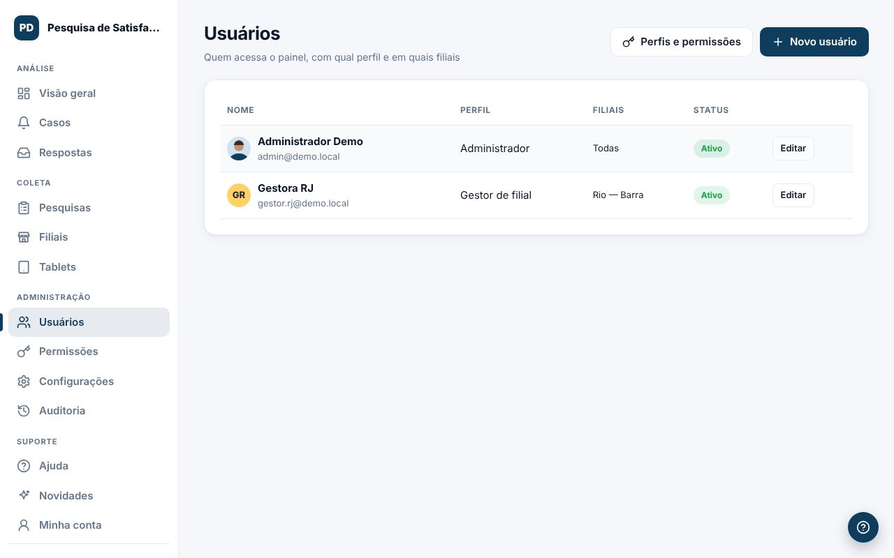

#### Cadastrar uma pessoa
1. Clique em `Novo usuário`.
2. Preencha nome, e-mail e uma senha inicial (mínimo de 10 caracteres, com letras e números).
3. Escolha o **Perfil de acesso**. A descrição do perfil aparece logo abaixo.
4. Marque as **filiais** que a pessoa pode ver (vale para perfis "só as filiais da pessoa").
5. Clique em `Salvar`.

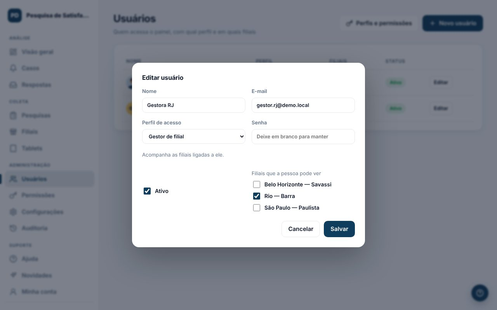

#### Outras ações
- **Desativar**: desmarque "Ativo". A pessoa perde o acesso na hora e a foto dela é apagada.
- **Resetar 2FA**: quando a pessoa perdeu o celular. Ela configura de novo no próximo login.
- **Remover foto**: para uma foto inadequada. Só a própria pessoa troca a foto.

#### Regras de segurança
- Você só vê e escolhe perfis que têm, no máximo, o mesmo acesso que o seu.
- Ninguém muda o próprio perfil nem se desativa.
- O sistema não deixa ficar sem nenhum administrador ativo.

### Perfis e permissões

Em **Perfis e permissões** você define, menu por menu, o que cada perfil pode **Ver**, **Incluir**, **Editar** e **Excluir**, além de ações específicas.

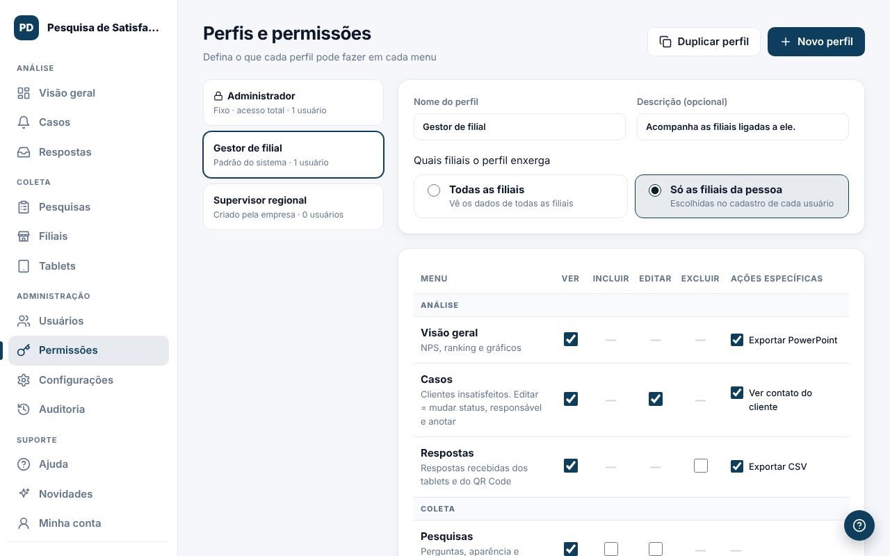

#### Perfis que já vêm prontos
- **Administrador**: acesso total. É fixo e não pode ser alterado nem excluído.
- **Gestor de filial**: vê os números e trata os casos das filiais ligadas a ele. Pode ser ajustado.

#### Criar um perfil
1. Clique em `Novo perfil` (ou `Duplicar perfil` para partir de um existente).
2. Dê um nome e, se quiser, uma descrição (ex.: "Diretoria que só acompanha os números").
3. Escolha quais filiais o perfil enxerga: **Todas as filiais** ou **Só as filiais da pessoa**.
4. Marque as permissões de cada menu e as ações específicas, como "Exportar CSV" ou "Ver contato do cliente".
5. Clique em `Salvar perfil`. Quem usa esse perfil já passa a ter as novas permissões, sem precisar entrar de novo.

#### Como as caixas funcionam
- Sem **Ver**, o menu some da barra lateral e o servidor recusa o acesso, mesmo por link direto.
- Marcar Incluir, Editar, Excluir ou uma ação específica marca **Ver** junto.
- Um traço (—) quer dizer que a ação não existe naquele menu.

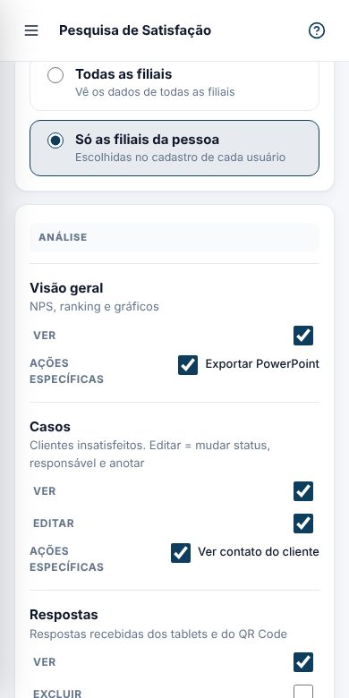

#### Regras de segurança
- Ninguém cria ou altera um perfil com mais acesso que o seu, nem dá a alguém um perfil maior que o seu.
- Perfis que alteram usuários, permissões ou configurações precisam de 2FA, se a empresa exigir.
- Toda mudança fica na [Auditoria](#auditoria) com o que entrou e o que saiu.
- Um perfil em uso não pode ser excluído: troque o perfil das pessoas antes.

### E-mail e WhatsApp (QR Code ou API da Meta)

Em **Configurações → E-mail e WhatsApp** você liga o envio dos avisos.

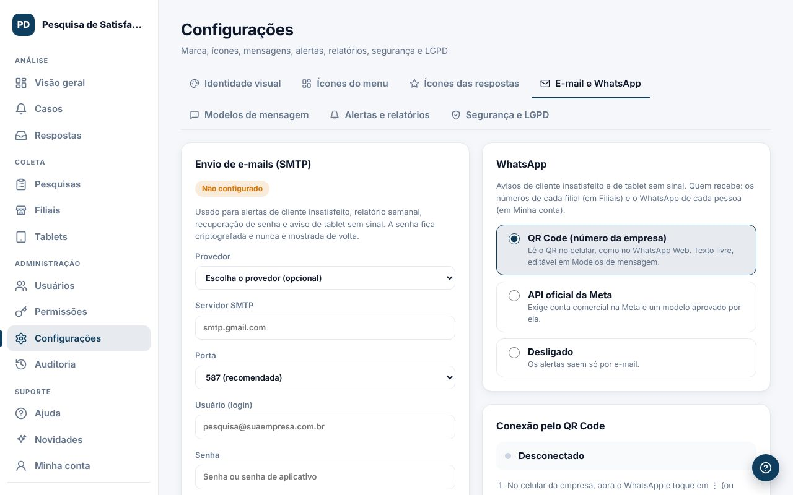

#### E-mail (SMTP)
1. Escolha o provedor (Gmail, Microsoft 365, Locaweb...) ou preencha servidor e porta.
2. Informe usuário, senha e o remetente.
3. Clique em `Salvar e-mail` e depois em `Enviar e-mail de teste para mim`.

> Dica: no Gmail, use uma "Senha de app" (myaccount.google.com/apppasswords), não a senha normal.

#### WhatsApp: escolha a forma de conexão
- **QR Code (número da empresa)**: você conecta um número como no WhatsApp Web. O texto das mensagens é livre e editável em [Modelos de mensagem](#modelos-mensagem).
- **API oficial da Meta**: exige conta comercial na Meta e um modelo de mensagem aprovado por ela.
- **Desligado**: os alertas saem só por e-mail.

#### Conectar pelo QR Code
1. Escolha **QR Code (número da empresa)** e clique em `Gerar QR Code`.
2. No celular da empresa, abra o WhatsApp e toque em **⋮** (ou Configurações) → **Aparelhos conectados** → **Conectar um aparelho**.
3. Aponte a câmera para o QR Code da tela. O estado muda para **Conectado**.

O QR Code só aparece para quem tem a permissão "Conectar e desconectar o WhatsApp".

#### Intervalo entre os envios
Os alertas saem **um por vez**. Antes de cada mensagem, o sistema sorteia uma pausa entre o mínimo e o máximo que você escolher (de 15 a 60 segundos). O primeiro aviso sai na hora. A **Fila do WhatsApp** mostra o horário de cada mensagem e a pausa sorteada.

#### Quem recebe
Os números cadastrados em cada filial e o WhatsApp de cada pessoa que marcou o alerta em [Minha conta](#minha-conta). Um número repetido recebe uma vez só.

#### Cuidados com o número
- Use um **chip só para os alertas**, não o número de atendimento.
- Peça para cada pessoa salvar o número e responder uma vez.
- Mandar só para a equipe, com pausas, deixa o risco de bloqueio bem baixo, mas não zero: o WhatsApp não autoriza oficialmente programas de terceiros.
- Se a conexão cair, os administradores recebem um e-mail. As mensagens esperam na fila por até 24 horas.

### Textos das mensagens (modelos)

Em **Configurações → Modelos de mensagem** você edita o texto de cada envio, no e-mail e no WhatsApp, e vê como ele vai chegar.

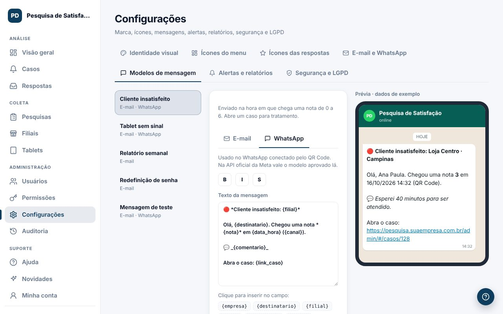

#### Tipos de envio
- **Cliente insatisfeito** (e-mail e WhatsApp)
- **Tablet sem sinal** (e-mail e WhatsApp)
- **Relatório semanal** (e-mail)
- **Redefinição de senha** (e-mail)
- **Mensagem de teste** (e-mail e WhatsApp)

#### Editar um texto
1. Escolha o tipo de envio e a guia **E-mail** ou **WhatsApp**.
2. Edite os campos. No e-mail: assunto, título, texto, texto do botão e rodapé. No WhatsApp: o texto da mensagem.
3. Clique numa variável, como `{filial}` ou `{nota}`, para inserir no ponto em que está o cursor.
4. Confira a **Prévia** ao lado, montada com dados de exemplo.
5. Clique em `Salvar modelo`. Os próximos envios já usam o novo texto.

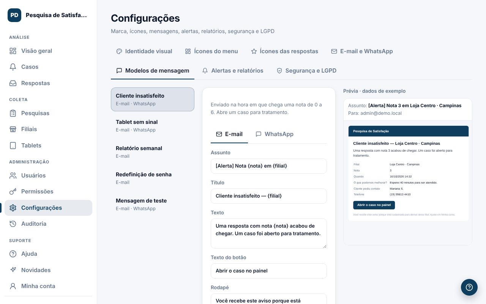

#### Bom saber
- No WhatsApp, use `*negrito*`, `_itálico_` e `~riscado~` (ou os botões B, I e S).
- Uma variável que não existe naquele tipo de envio é recusada ao salvar.
- No e-mail, a tabela com os dados (filial, nota, comentários e contato) entra sozinha, abaixo do texto.
- `Restaurar texto padrão` volta ao texto original.
- `Enviar teste para mim` manda o modelo salvo para o seu e-mail ou para o seu WhatsApp de Minha conta.
- Na API oficial da Meta, vale o modelo aprovado lá. O texto livre vale para o WhatsApp conectado pelo QR Code.

### Alertas, metas e relatório semanal

Em **Configurações → Alertas e relatórios** você liga os avisos automáticos.

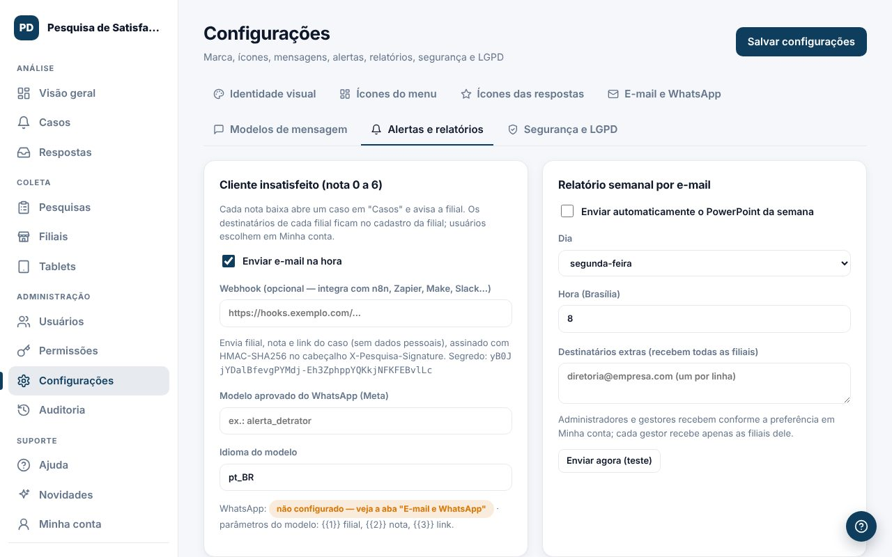

#### Cliente insatisfeito (nota de 0 a 6)
- **Enviar e-mail na hora**: avisa os e-mails da filial e quem marcou o alerta em Minha conta.
- **Webhook** (opcional): envia filial, nota e link do caso para ferramentas como n8n, Zapier ou Make, sem dados pessoais.
- **Modelo aprovado do WhatsApp (Meta)**: só para quem usa a API oficial da Meta.

#### Relatório semanal
Marque **Enviar automaticamente o PowerPoint da semana** e escolha o dia e a hora. Cada pessoa recebe só as filiais dela. Os "destinatários extras" recebem todas as filiais. O botão `Enviar agora (teste)` envia na hora.

#### Tela do tablet e bateria
Mantenha a tela acesa e escureça depois de um tempo sem toque. Um toque volta ao brilho normal.

#### Metas e alertas
- **Meta de NPS padrão**: vale para as filiais sem meta própria.
- **Tablet sem sinal**: avisa quando um tablet fica sem contato por X minutos dentro do horário de funcionamento.

### Identidade visual e ícones

Em **Configurações → Identidade visual** você deixa o sistema com a cara da empresa.

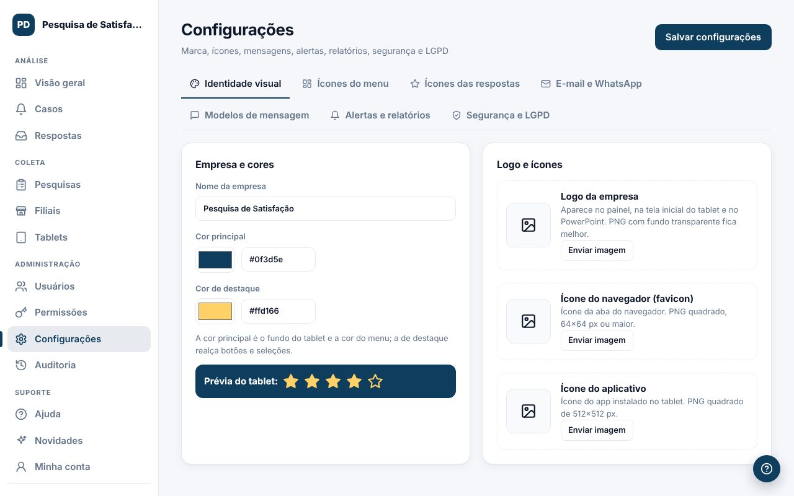

#### Identidade visual
- **Nome da empresa**, **cor principal** (fundo do tablet e menu) e **cor de destaque** (botões e seleções).
- **Logo**: aparece no painel, no tablet, na tela de entrada e no PowerPoint.
- **Ícone do navegador** e **ícone do aplicativo** instalado no tablet.

#### Ícones do menu
Escolha o ícone de cada item do menu lateral. A mudança vale para todos.

#### Ícones das respostas
Escolha o estilo padrão das escalas: números coloridos, carinhas ou ícones (estrela, coração e outros), e as cores por faixa do NPS ou em gradiente.

Clique em `Salvar configurações` no topo. Os tablets recebem as mudanças em até 1 minuto.

### Segurança, LGPD e prazos de guarda

Em **Configurações → Segurança e LGPD** ficam o 2FA obrigatório, os prazos de guarda, o aviso de privacidade e os pedidos dos clientes.

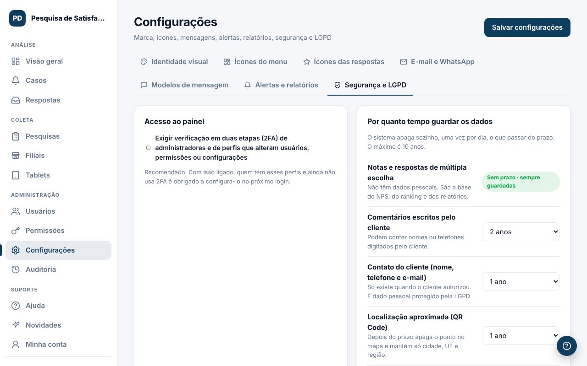

#### Acesso ao painel
Com **Exigir verificação em duas etapas** ligado, administradores e perfis que alteram usuários, permissões ou configurações precisam usar 2FA.

#### Por quanto tempo guardar os dados
O sistema apaga sozinho, uma vez por dia, o que passar do prazo. O máximo é **10 anos**.
- **Notas e respostas de múltipla escolha**: sem prazo. Não têm dados pessoais e são a base dos relatórios.
- **Comentários escritos pelo cliente**: de 1 a 10 anos.
- **Contato do cliente** (nome, telefone e e-mail): de 1 a 10 anos.
- **Localização aproximada** (QR Code): depois do prazo, apaga o ponto no mapa e mantém só cidade, UF e região.
- **Registro de auditoria**: de 6 meses a 10 anos.

> Dica: a LGPD pede que dados pessoais fiquem guardados só pelo tempo necessário. Para os contatos, prefira 1 ou 2 anos. Acima de 2 anos, a tela mostra um aviso para você registrar o motivo no controle de tratamento de dados da empresa.

#### Aviso de privacidade
Texto exibido no tablet e no QR Code antes do cliente deixar contato ou localização.

#### Pedido do titular
Quando um cliente pedir acesso ou exclusão dos dados dele:
1. Informe o telefone ou o e-mail e clique em `Localizar`.
2. Use `Exportar dados (JSON)` para entregar uma cópia ou `Excluir dados` para apagar contato e comentários. As notas ficam, sem ligação com a pessoa.

### Auditoria

A **Auditoria** mostra quem fez o quê no sistema, em linguagem simples. São as últimas 500 ações.

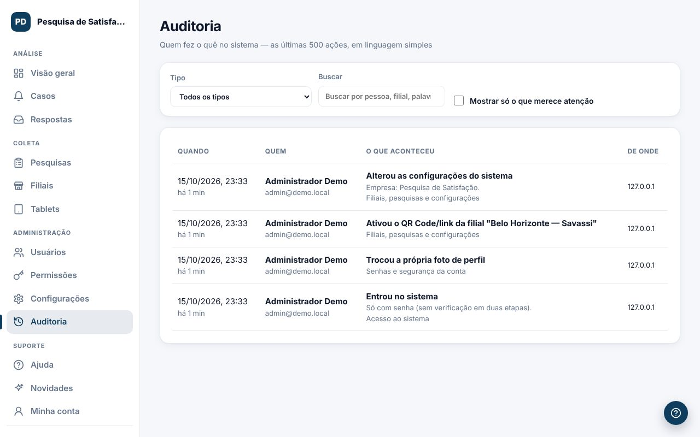

#### Como usar
- Filtre por **Tipo** (acesso, usuários, cadastros, tablets, dados, LGPD...).
- Busque por pessoa, filial ou palavra.
- Marque **Mostrar só o que merece atenção** para ver avisos e ações importantes.

#### O que fica registrado
- Entradas, saídas e tentativas de acesso recusadas.
- Criação e alteração de usuários e de **perfis de acesso**, com as permissões que entraram e saíram.
- Mudanças de filiais, pesquisas, configurações e **textos das mensagens**.
- Conexão e desconexão do WhatsApp.
- Exportações, exclusões e cada vez que alguém vê o contato de um cliente.

O prazo de guarda da auditoria é definido em [Segurança e LGPD](#lgpd).

## Dúvidas

### Perguntas frequentes

#### Não vejo um menu que um colega vê. Por quê?
O menu depende do seu **perfil de acesso**. Peça a quem administra os usuários para conferir o seu perfil em [Perfis e permissões](#permissoes).

#### O tablet está "Offline". Perdi as respostas?
Não. Sem internet, as respostas ficam guardadas no tablet e são enviadas quando a conexão volta, sem duplicar.

#### O cliente respondeu pelo QR Code fora do horário. Vale?
Vale. O horário de funcionamento só controla o tablet da loja.

#### Como mudo o texto do aviso que chega no WhatsApp?
Em [Modelos de mensagem](#modelos-mensagem), escolha "Cliente insatisfeito" e a guia WhatsApp.

#### Os alertas de WhatsApp demoram para chegar a todos. É normal?
É. Para proteger o número, o sistema envia um por vez, com uma pausa sorteada de 15 a 60 segundos. Com 4 pessoas, o último chega em cerca de 1 a 3 minutos.

#### O WhatsApp aparece como "Desconectado".
O celular pode ter desconectado o sistema (em Aparelhos conectados) ou o número foi trocado. Gere um novo QR Code em [E-mail e WhatsApp](#email-whatsapp) e leia com o celular.

#### Esqueci a senha e não recebo o e-mail.
Confira a caixa de spam. Se a empresa ainda não configurou o envio de e-mails, peça a quem administra os usuários para definir uma nova senha.

#### Onde vejo o que mudou no sistema?
No menu **Novidades**. Lá ficam as notas de cada versão, com prints.
