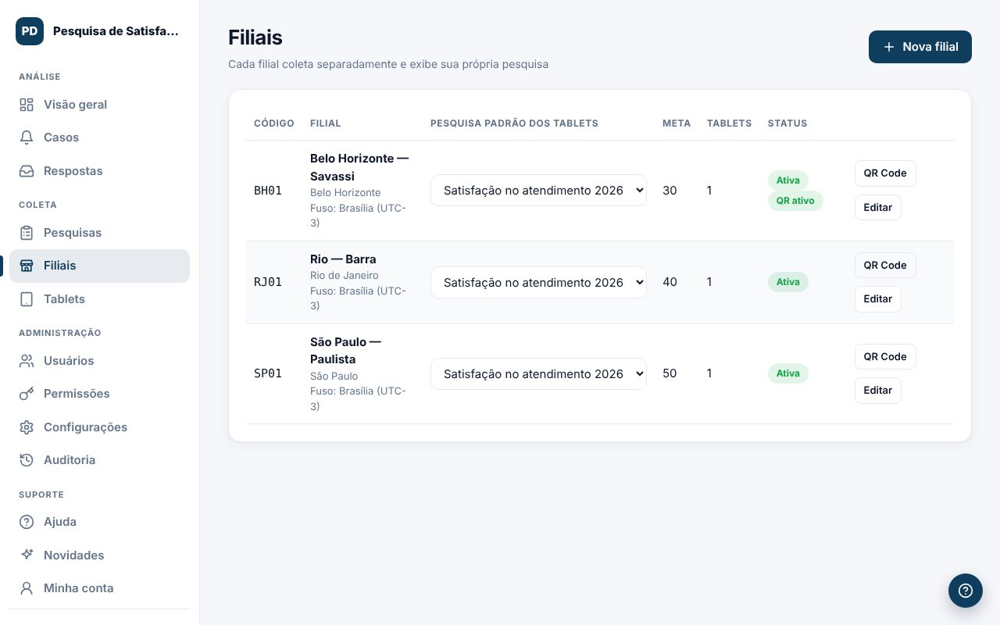
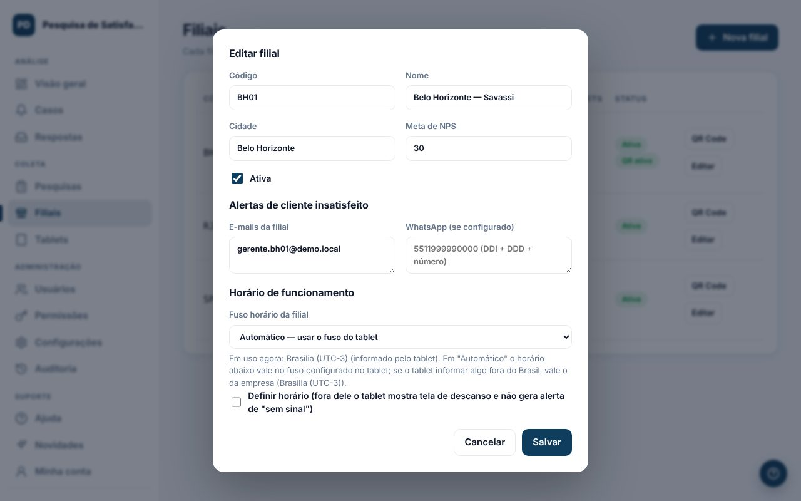

Cada filial coleta separadamente e tem a sua pesquisa, seus alertas e seu horário.

## Cadastrar ou editar
1. Clique em `Nova filial` ou em `Editar`.
2. Preencha código, nome, cidade e a **meta de NPS** (se vazia, vale a meta padrão).
3. Em **Alertas de cliente insatisfeito**, informe os e-mails e os números de WhatsApp da filial (DDI + DDD + número).
4. Escolha o **fuso horário** e, se quiser, o **horário de funcionamento** de cada dia.
5. Clique em `Salvar`.

## Horário de funcionamento
Fora do horário, o tablet mostra uma tela de descanso e o sistema não avisa "tablet sem sinal". O QR Code continua aceitando respostas.

## Pesquisa dos tablets
Na lista de filiais, escolha a pesquisa padrão na coluna **Pesquisa padrão dos tablets**. Os tablets recebem a mudança em até 1 minuto.

## QR Code
O botão `QR Code` abre o link e o cartaz da filial. Veja [QR Code para o cliente](#/ajuda/qr-code).
