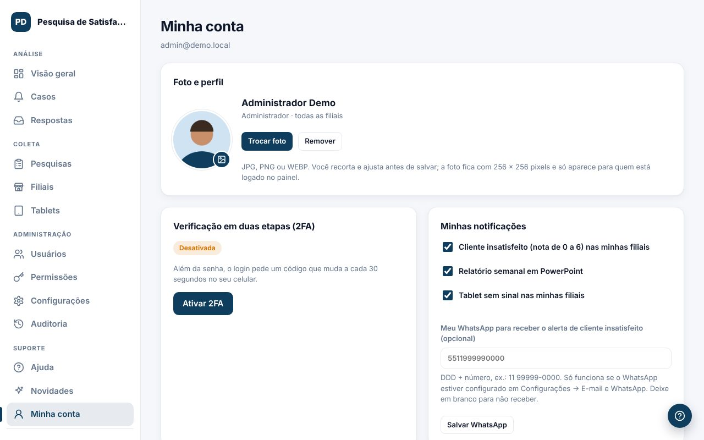

Em **Minha conta** cada pessoa cuida dos próprios dados. Todos os perfis têm acesso.

## Foto de perfil
1. Clique em `Enviar foto` (ou na própria foto) e escolha uma imagem JPG, PNG ou WEBP.
2. Arraste a foto para posicionar e use o **Zoom** para ajustar. Só a parte dentro do círculo aparece.
3. Clique em `Salvar foto`.

A foto aparece no menu lateral, na lista de usuários e nos casos (responsável e histórico). Ela só é vista por quem está logado no painel. Para tirar, clique em `Remover`.

## Notificações
Marque o que você quer receber:
- **Cliente insatisfeito** (nota de 0 a 6) nas suas filiais.
- **Relatório semanal** em PowerPoint.
- **Tablet sem sinal** nas suas filiais.

## Seu WhatsApp
Informe DDD + número (ex.: 11 99999-0000) para receber os alertas também pelo WhatsApp. Funciona quando o WhatsApp estiver ligado em [E-mail e WhatsApp](#/ajuda/email-whatsapp). Deixe em branco para não receber.

## Trocar senha
Digite a senha atual e a nova duas vezes. Depois da troca, todas as suas sessões abertas são encerradas e você entra de novo.
