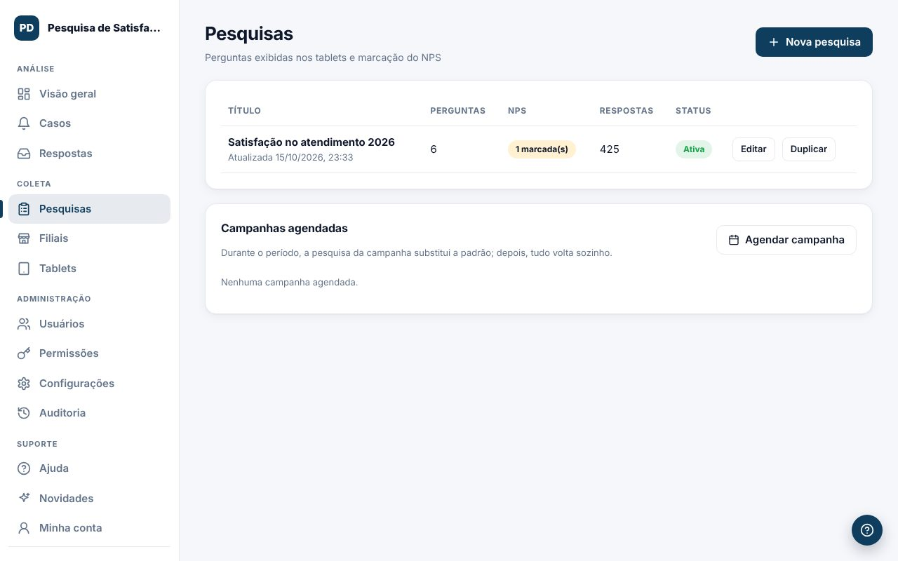
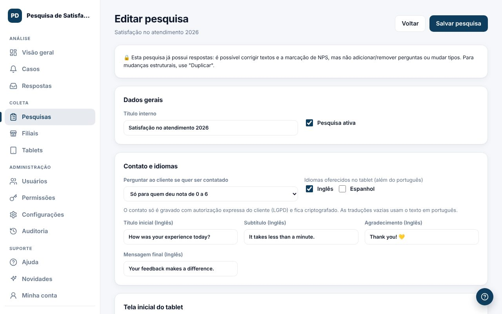

A pesquisa é o que o cliente vê no tablet e no QR Code.

## Criar uma pesquisa
1. Em **Pesquisas**, clique em `Nova pesquisa`.
2. Preencha o título interno, a tela inicial e a tela de agradecimento.
3. Adicione as perguntas (até 30). Tipos: NPS de 0 a 10, escala de 1 a 5, escolha única, múltipla escolha, sim/não e texto livre.
4. Nas perguntas de 0 a 10, marque **"Entra na análise de NPS"** nas que contam para o indicador.
5. Clique em `Salvar pesquisa`.

## Opções úteis
- **Aparência** das escalas: números coloridos, carinhas ou ícones. O valor gravado é sempre a nota de 0 a 10.
- **Perguntas condicionais**: mostre uma pergunta só para certas respostas (ex.: "O que podemos melhorar?" só para notas até 6).
- **Idiomas**: português, inglês e espanhol. Traduções vazias usam o texto em português.
- **Contato**: pergunte se o cliente quer ser contatado (nunca, só detratores ou todos). O contato só é gravado com autorização.
- **Imagem ou vídeo** de agradecimento (até 25 MB) e o tempo na tela.

> Dica: quando a pesquisa já tem respostas, dá para corrigir textos, a marcação de NPS, as condições e as ramificações, mas não mudar a estrutura. Para isso, use `Duplicar`.

## Ramificação conforme a resposta
Leve o cliente para outra pergunta, ou encerre a pesquisa, de acordo com o que ele respondeu.

1. Na pergunta (nota, sim/não ou opções), clique em `+ Ramificação`.
2. Escolha a regra, por exemplo **"Se a resposta for menor ou igual a 6"**.
3. Escolha o destino: **Ir para a pergunta N** (sempre uma pergunta adiante) ou **Encerrar a pesquisa**.
4. Adicione outras regras se precisar. Vale a primeira que for atendida. As demais respostas seguem para a próxima pergunta.

Exemplo: na pergunta de NPS, notas de 0 a 6 vão para "O que deu errado?" e notas 9 e 10 encerram a pesquisa. O tablet mostra o progresso só com as perguntas do caminho ("2 de 3"), e o botão `Voltar` refaz o mesmo caminho.

As perguntas puladas não aparecem nas respostas e não contam como sem resposta. Ramificação e pergunta condicional podem ser usadas juntas.

## Escolher a pesquisa dos tablets
A pesquisa padrão de cada filial é escolhida na tela [Filiais](#/ajuda/filiais).
