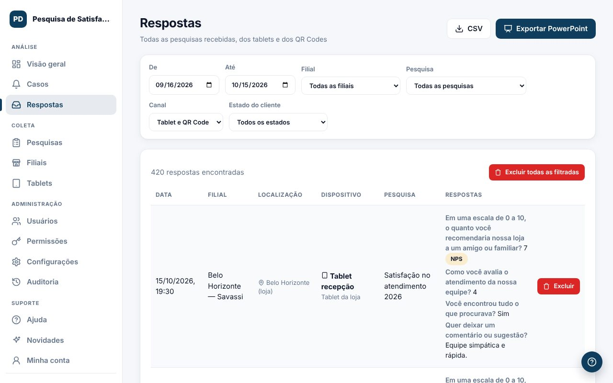

Em **Respostas** você vê cada pesquisa recebida, dos tablets e dos QR Codes.

## O que aparece em cada linha
- Data, filial e pesquisa.
- **Localização**: no QR Code, a cidade e o estado aproximados (só se o cliente autorizou); no tablet, a cidade da loja.
- **Dispositivo**: o nome do tablet ou o tipo de celular do cliente.
- Todas as respostas dadas.

## Exportar
Use `CSV` para baixar a planilha com os filtros da tela. A exportação fica registrada na auditoria.

## Excluir respostas
Perfis com a permissão **Respostas · Excluir** podem apagar uma resposta ou todas as filtradas (útil para limpar testes). Para excluir em lote, é preciso digitar **EXCLUIR**. Isso não pode ser desfeito.
