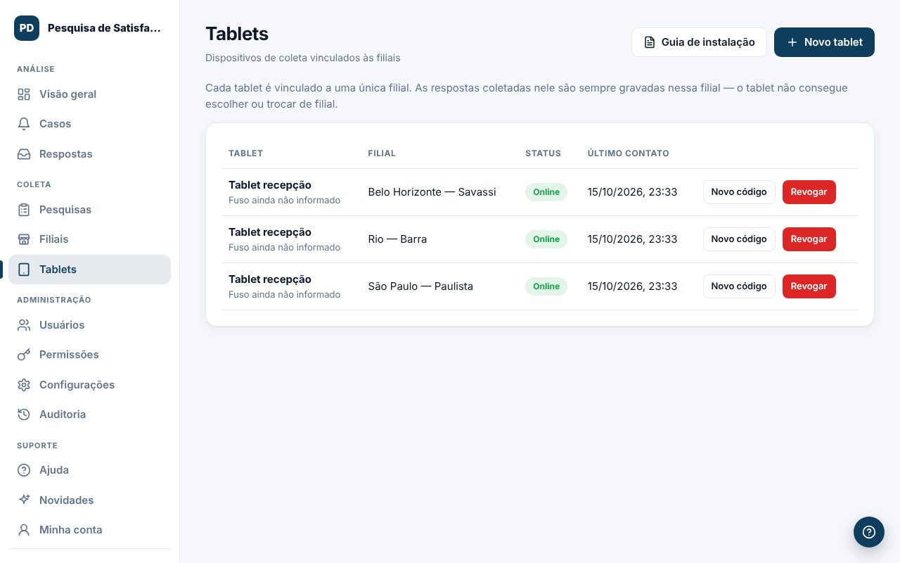

Cada tablet fica ligado a uma única filial. As respostas coletadas nele são sempre gravadas nessa filial.

## Instalar um tablet
1. Em **Tablets**, clique em `Novo tablet`, escolha a filial e dê um nome (ex.: Tablet recepção).
2. Clique em `Gerar código`. O código de 8 letras vale por 15 minutos e funciona uma única vez.
3. No tablet, abra o endereço mostrado na tela (termina em `/kiosk/`) e digite o código.
4. Siga o `Guia de instalação` para travar o tablet no modo quiosque (Android com Fully Kiosk ou iPad com Acesso Guiado).

## Situação de cada tablet
- **Online**: falou com o sistema nos últimos 3 minutos.
- **Offline**: sem contato. Sem internet, as respostas ficam guardadas no tablet e são enviadas quando a conexão volta.
- **Aguardando pareamento** ou **Código expirado**.

## Tablet perdido ou trocado
- `Revogar` corta o acesso na hora.
- `Novo código` desconecta o tablet atual até ele ser pareado de novo.

O guia completo também está em `docs/INSTALACAO-TABLET.md`.
