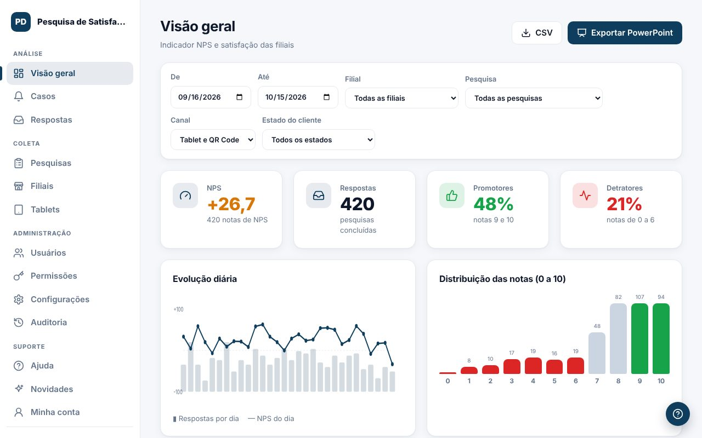

A **Visão geral** mostra o NPS e a satisfação das filiais no período escolhido.

## Filtros
Escolha o período (**De** e **Até**), a filial, a pesquisa, o canal (tablet ou QR Code) e o estado do cliente. Os números, gráficos e exportações seguem os filtros.

## Como ler o NPS
- **Promotores**: notas 9 e 10. **Neutros**: 7 e 8. **Detratores**: 0 a 6.
- O **NPS vai de 0 a 100**: 0 quando todos são detratores, 50 quando promotores e detratores empatam e 100 quando todos são promotores.
- Cores: **verde** a partir de 75, **amarelo** de 50 a 74 e **vermelho** abaixo de 50.
- Quem estiver acostumado à conta clássica (% de promotores − % de detratores, de −100 a +100) chega ao mesmo número fazendo (clássico + 100) ÷ 2.
- Só entram no NPS as perguntas marcadas como **"Entra na análise de NPS"** no editor da pesquisa.

## O que mais aparece
- **Evolução diária**: respostas por dia (barras) e NPS do dia (linha).
- **Distribuição das notas** de 0 a 10.
- **Ranking das filiais** com a meta de NPS de cada uma.
- **Origem das respostas pelo QR Code**: cidade e estado de quem autorizou a localização.
- **NPS por pergunta** e **comentários recentes**.

## Exportar
- `Exportar PowerPoint`: relatório com gráficos editáveis, logo e cores da empresa.
- `CSV`: planilha com as respostas (abre no Excel).

> Dica: os botões de exportação só aparecem para perfis com essas permissões.
